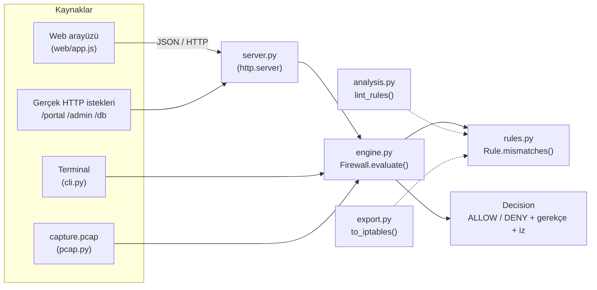
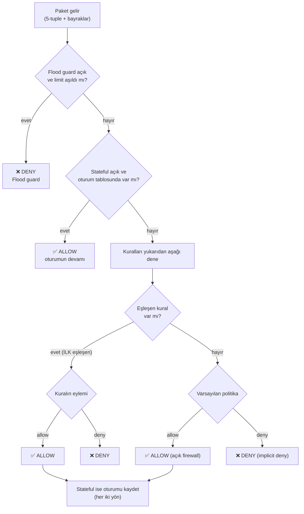

# 🛡️ MiniFirewall Lab

**IP, Port ve Protokol Tabanlı Paket Filtreleme Simülasyonu**

*Bilgi Güvenliğinin Temelleri · Chapter 10 — Networks and Telecommunications · Firewall bölümü*

Gerçek bir ağ kartına dokunmadan, bir güvenlik duvarının **her pakete nasıl karar verdiğini** adım adım gösteren küçük ama eksiksiz bir laboratuvar. Aynı karar motoru üç farklı "pencereden" izlenebilir:

| Pencere | Komut | Ne gösterir? |
|---|---|---|
| 🖥️ **Web arayüzü** | `python3 run.py` | Animasyonlu topoloji, canlı log, kural editörü, saldırı butonları |
| ⌨️ **Terminal** | `python3 run.py demo` / `quiz` / `trace` / `lint` | Aynı motor, kod okunabilirliğinde çıktı |
| 📦 **PCAP** | `python3 run.py pcap demo/capture.pcap` | Wireshark benzeri gerçek yakalama dosyasını kurallardan geçirir |

> **Dış bağımlılık yok.** Sadece Python standart kütüphanesi. `pip install` gerekmez, internet gerekmez.

---

## İçindekiler

1. [Hızlı başlangıç](#-hızlı-başlangıç)
2. [Kitaptaki kavramlar → projede nerede?](#-kitaptaki-kavramlar--projede-nerede)
3. [Nasıl çalışıyor?](#-nasıl-çalışıyor)
4. [Kural dili](#-kural-dili)
5. [Web arayüzü rehberi](#-web-arayüzü-rehberi)
6. [Komut satırı](#-komut-satırı)
7. [Senaryolar](#-hazır-senaryolar)
8. [Dosya yapısı ve kodu nereden okumalı?](#-dosya-yapısı)
9. [HTTP API](#-http-api)
10. [Testler](#-testler)
11. [Sınırlamalar (dürüst liste)](#-sınırlamalar)
12. [Sorun giderme](#-sorun-giderme)

---

## 🚀 Hızlı başlangıç

**Gereksinim:** Python **3.10+** (3.12 ile test edildi).

```bash
cd "Sunum Ödevi"

python3 run.py                  # web arayüzü → http://localhost:8080 (tarayıcı kendiliğinden açılır)
python3 run.py demo --step      # terminal demosu, her bölümde Enter bekler
python3 run.py quiz             # "ALLOW mı DENY mi?" yarışması
python3 -m unittest discover -s tests   # 43 test
```

Port doluysa: `python3 run.py --port 9000 --no-browser`

---

## 📖 Kitaptaki kavramlar → projede nerede?

| Kitaptaki ifade (Ch. 10) | Projedeki karşılığı |
|---|---|
| *Packet filtering* — her paketi kurallara karşı kontrol eder, geçmişi hatırlamaz | `Firewall.evaluate()` — stateful kapalıyken her paket bağımsızdır (`engine.py`) |
| *Access control list* — host + protokol + port için kural | `Rule` sınıfı ve kural dili (`rules.py`) |
| *Allow / deny* eylemleri | `action: allow \| deny` |
| *Implicit deny* — açıkça izin verilmeyen her şey engellenir | Varsayılan politika **DENY** (üstteki ALLOW/DENY anahtarı) |
| *Stateful inspection* — ilk pakette kurallara bak, oturumu hatırla | `stateful=True` → oturum tablosu (`_states`) |
| *Flood guard* — bir hostun trafiğini sınırla | `flood_limit` → kaynak IP başına kayan pencere hız sınırı |
| *Network separation* — ağlar arası trafiği kural ile ayır | Senaryo **4 · DMZ**: DMZ'den iç DB'ye erişim yasak |
| *Screened subnet / DMZ* | Aynı senaryo + topolojideki Web/DB düğümleri |
| *Firewalls are detective controls too* — loglar | Canlı karar akışı + kural eşleşme sayaçları |
| *Rule-based management* | Kural editörü, sıra değiştirme, açma/kapama, **lint** |
| Application proxy (kapsam dışı) | `DNS tüneli` saldırısı bunun **neden gerektiğini** gösterir (bkz. [Sınırlamalar](#-sınırlamalar)) |

---

## ⚙️ Nasıl çalışıyor?

### Mimari



Tek bir **karar motoru** var (`engine.py`). Arayüz, terminal ve PCAP yalnızca farklı "paket kaynakları" ve farklı "gösterim biçimleri". Bu yüzden terminalde ve ekranda gördüğün karar **birebir aynı koddan** çıkar. Web arayüzündeki **`</> Kaynak kod`** düğmesi bu dosyaları canlı gösterir.

### Karar akışı

Bir paket motora girdiğinde şu sırayla dolaşır:



### Bir kural bir paketle nasıl eşleşir?

`Rule.mismatches(packet)` paketle **uyuşmayan alanların listesini** döndürür. Liste boşsa kural eşleşmiştir. Aynı fonksiyon hem kararı hem de arayüzdeki *"neden eşleşmedi?"* açıklamasını besler:

| Alan | Eşleşme koşulu |
|---|---|
| Protokol | Kuralda `any` ise her zaman; değilse paketin protokolüyle aynı |
| Kaynak / Hedef IP | Paketin IP'si, kuraldaki `any` / tek IP / `CIDR` / virgüllü listeden **birinin** içinde |
| Kaynak / Hedef port | TCP/UDP paketlerinde, `any` / tek port / liste / `aralık`'tan birinin içinde (ICMP port taşımaz) |
| TCP bayrakları | Kuralın istediği bayrakların **tümü** pakette varsa (`flags=SYN` → `SYN` ve `SYN ACK` eşleşir) |

Tüm alanlar **VE** ile birleşir; bir tanesi bile uymazsa kural atlanır.

### Stateful inspection

```text
1) 10.0.0.42:51515 → 93.184.216.34:443  [SYN]     kural #1 izin verir  → tabloya İKİ yön yazılır
2) 93.184.216.34:443 → 10.0.0.42:51515  [SYN ACK] kural listesinde karşılığı YOK
                                                  ama tabloda var → ALLOW (stateful)
```

* Oturum 120 sn hatırlanır (`STATE_TTL`).
* **Sadece izin verilen** paketler oturum açar; engellenen paketin dönüşü de engellenir.
* Stateful kapalıyken aynı dönüş paketi `DENY` olur — kitaptaki "packet filter hafızasızdır" cümlesinin canlı kanıtı.

### Flood guard

Her kaynak IP için son `1 sn` içindeki paket zamanları bir kuyrukta tutulur (kayan pencere). Sayı limiti (varsayılan **30/sn**) aşarsa fazlası kesilir. Engellenen paketler de sayılır; yani saldırgan saldırmaya devam ettikçe engel sürer, susunca pencere boşalır.

> ⚠️ Limit **kaynak başına**dır. Tek kaynaklı `SYN seli` kesilir (150 paketin 120'si düşer) ama **her paketi farklı IP'den gelen DDoS 160/160 geçer.** Bu bilinçli bir öğretim noktası: hız sınırı tek başına dağıtık saldırıyı durdurmaz.

### Kural analizi (lint)

“İlk eşleşen kazanır” kuralı yüzünden **sıra güvenliği belirler**. `analysis.py` kuralları kümeler olarak karşılaştırır:

| Bulgu | Anlamı | Seviye |
|---|---|---|
| `shadowed` | Kural, üstündeki bir kural tarafından tamamen kapsanıyor → **hiç çalışmaz**; eylemler farklıysa gerçek güvenlik açığı | 🔴 hata |
| `redundant` | Aynı, ama eylemler aynı → gereksiz | 🟡 uyarı |
| `broad` | `any → any`, tüm portlara ALLOW | 🟡 uyarı |
| `policy` | Varsayılan politika ALLOW | 🟡 uyarı |
| `overlap` | Karşıt eylemli kısmi çakışma → sıra sonucu belirler | 🔵 bilgi |

Kapsama testi: protokol (`any` her şeyi kapsar), CIDR (`subnet_of`), port aralıkları (birleştirilmiş aralıkların içinde mi), bayraklar (daha az bayrak = daha geniş).

### iptables karşılığı

`export.py` aynı kural listesini gerçek Linux komutlarına çevirir (`FORWARD` zinciri). Örnek:

```text
allow tcp any any 10.0.0.10 443   # HTTPS
        ↓
iptables -A FORWARD -p tcp -d 10.0.0.10/32 --dport 443 -m comment --comment "HTTPS" -j ACCEPT
```

`deny` → `DROP`, varsayılan politika → `iptables -P FORWARD DROP`, stateful → `-m conntrack --ctstate ESTABLISHED,RELATED`, flood guard → `-m hashlimit`. Çıktı **okumak içindir**, çalıştırmak için değil.

### "Gerçek" HTTP istekleri

Arayüzdeki `/portal`, `/admin`, `/db` bağlantıları tarayıcıdan **gerçek bir HTTP isteği** gönderir. Sunucu bu isteği temsil ettiği pakete çevirip (kaynak `127.0.0.1`) aynı motordan geçirir ve sonucu bir sayfa olarak döner. Karar motoru gerçektir; paket **temsilidir** (işletim sistemi paketi yakalanmaz). Sayfa bunu açıkça yazar.

---

## 📝 Kural dili

iptables'e benzeyen, tek satırlık bir dil:

```text
ACTION PROTO KAYNAK SPORT HEDEF DPORT [flags=SYN] [# yorum]
```

| Alan | Değerler |
|---|---|
| `ACTION` | `allow` · `deny` (`accept / permit / pass` ve `drop / block / reject` takma adları) |
| `PROTO` | `any` · `tcp` · `udp` · `icmp` |
| `KAYNAK`, `HEDEF` | `any` · `10.0.0.5` · `10.0.0.0/24` · `10.0.0.5,10.0.0.9` |
| `SPORT`, `DPORT` | `any` · `443` · `80,443` · `1024-65535` (`1024:65535` de olur) |
| `flags=` | `SYN`, `SYN ACK` … (opsiyonel, yalnızca TCP) |

```text
allow tcp any any 10.0.0.10 443              # Web sunucusu (HTTPS)
deny  tcp any any 10.0.0.20 22               # SSH'i herkese kapat
allow tcp 203.0.113.0/24 any 10.0.0.20 22    # Sadece ofis subneti
allow udp any any 10.0.0.53 53               # DNS
allow tcp 10.0.0.0/24 1024-65535 10.0.0.30 3306
```

Hatalı kural (`allow tcp 999.1.1.1 …`, `70000` portu, `90-80` aralığı) sunucuya hiç girmez; satır içinde açıklayıcı hata alırsın.

---

## 🖥️ Web arayüzü rehberi

```text
┌──────────────────────────────────────────────────────────────────────────┐
│ Senaryo ▾  [ALLOW|DENY]  ◉Stateful  ◉Flood guard  ◉Canlı trafik  Sıfırla  $ iptables  </> Kaynak kod │
├───────────────┬──────────────────────────────────────┬───────────────────┤
│ PAKET ÜRETECİ │            TOPOLOJİ                  │    KURALLAR       │
│ 5-tuple formu │  Saldırgan ─┐          ┌─ Web :80/443 │ 1 ALLOW …         │
│ [Paketi gönder]│  Ofis ağı ──┼─ 🛡 FW ──┼─ DNS :53     │ 2 DENY  ⚠ asla…   │
│ SALDIRILAR    │  İç ağ ─────┘          ├─ SSH :22     │ ↑ ↓ ◉ ✕ düzenle   │
│ 🔍 🌊 🤖 🔑…  │                        └─ DB  :3306   │                   │
│ Kural söz-    │  Toplam · Geçen · Engel · %Oran · Flood │                   │
│ dizimi        │  [BURST / ALLOW / DENY kartı] [Kural izi]│                   │
├───────────────┴──────────────────────────────────────┴───────────────────┤
│ CANLI KARAR AKIŞI  (filtre: Tümü / Geçen / Engel)                        │
└──────────────────────────────────────────────────────────────────────────┘
```

| Öğe | Ne yapar? |
|---|---|
| **Paket üreteci** | Kaynak/hedef IP-port, protokol, TCP bayrakları. Üstteki çipler (`Web :443`, `DNS :53`…) hedefi tek tıkla doldurur. **Paketi gönder** (veya Enter). |
| **Saldırı senaryoları** | Port taraması, SYN seli, DDoS, SSH brute force, DNS tüneli, Ping sweep, DMZ→DB. Tek tık, yüzlerce paket. |
| **Topoloji** | Paketler soldan sağa uçar. İzin → hedef servise ulaşır (yeşil), engel → güvenlik duvarında patlar (kırmızı). |
| **Kural listesi** | Satıra tıkla = düzenle. `↑ ↓` sırayı değiştir, `◉` aç/kapa, `✕` sil. Altındaki ince çubuk eşleşme sayısını gösterir. Lint rozetleri (`⚠ asla çalışmaz`) üzerine gelince açıklama verir. |
| **Kural izi** | Son karar için kural kural “eşleşti / atlandı + neden” tablosu. |
| **Yanıtı gönder ↺** | İzin verilen paketin dönüş paketini gönderir → stateful farkını canlı gösterir. |
| **Stateful** | Oturum tablosunu aç/kapat. |
| **Flood guard** | Kaynak başına 30 paket/sn sınırı. |
| **Canlı trafik** | Arka planda sürekli gerçekçi trafik (çoğu normal + arada saldırgan) üretir; ekran boş kalmaz. |
| **$ iptables** | Mevcut kuralların gerçek iptables karşılığı (kod çekmecesinde, **anlık** üretilir). |
| **</> Kaynak kod** | Motorun gerçek kaynak kodu, sözdizimi renkli, dosya sekmeli. |
| **Sıfırla** | Sayaçları, logu ve oturum tablosunu temizler. |

Kısayol: `Esc` açık pencereyi/çekmeceyi kapatır.

---

## ⌨️ Komut satırı

```bash
python3 run.py                         # web arayüzü (varsayılan)
python3 run.py serve --port 9000 --no-browser --scenario flood

python3 run.py demo                    # 7 bölümlük hikayeli terminal demosu
python3 run.py demo --step             # her bölümde Enter bekler (sunum modu)

python3 run.py quiz                    # 10 soruluk interaktif ALLOW/DENY yarışması
python3 run.py quiz --auto             # tahmin sormadan tüm cevapları göster

python3 run.py trace --src 198.51.100.66 --dst 10.0.0.20 --dport 22
python3 run.py trace --scenario bastion --src 203.0.114.5 --dst 10.0.0.20 --dport 22

python3 run.py lint --scenario messy   # gölgelenmiş / gereksiz kural analizi
python3 run.py iptables --scenario web # kuralların iptables karşılığı

python3 run.py pcap demo/capture.pcap --scenario web
python3 run.py pcap demo/capture.pcap --scenario dmz --slow 0.4   # canlı akış efekti
python3 run.py pcap demo/capture.pcap --rules benim_kurallarim.txt
```

`--rules` dosyasında satır başına bir kural bulunur; boş satırlar ve `#` ile başlayanlar yok sayılır.

`demo/capture.pcap` yeniden üretmek için: `python3 tools/make_pcap.py`

---

## 🧪 Hazır senaryolar

| # | Ad | Politika | Gösterdiği kavram |
|---|---|---|---|
| 1 | Açık firewall | ALLOW, kural yok | Filtre olmayınca ne olur — baseline |
| 2 | Web sunucusu | DENY | Temel ACL, implicit deny, açık-kapalı port |
| 3 | SSH bastion | DENY | Aynı port, **farklı kaynak IP** → farklı sonuç (CIDR) |
| 4 | Katmanlı / DMZ | DENY | Network separation: DMZ → DB yasak, App → DB serbest |
| 5 | Saldırı altında | DENY | Tek IP'yi tamamen kesme, kademeli savunma |
| 6 | Stateful inspection | DENY + stateful | Dönüş paketi kural olmadan geçer |
| 7 | Flood guard | DENY + hız sınırı | Tek kaynaklı sel kesilir, DDoS kesilmez |
| 8 | Hatalı kural sırası | DENY | **Tuzak:** üstteki `allow any` alttaki SSH yasağını öldürür |

Her senaryoda **Saldırı** butonlarını deneyip sonuçları karşılaştır. Örneğin `Port taraması` senaryo 1'de 150/150 geçer, senaryo 2'de 148/150 engellenir.

---

## 📁 Dosya yapısı

```text
Sunum Ödevi/
├── run.py                    giriş noktası
├── README.md                 bu dosya
├── KAVRAMLAR.md               firewall/IP/port/protokol kavramları sıfırdan anlatılıyor
├── PROJE_REHBERI.md           projenin ne/neden/nasıl çalıştığı, kod turu, test rehberi
├── SUNUM_AKISI.md            15-20 dk'lık sunum akışı ve konuşma notları
├── Kitap-CHAPTER10.pdf       kaynak kitap bölümü
│
├── minifirewall/             ← asıl proje (saf Python, bağımlılıksız)
│   ├── packet.py             Paket modeli (5-tuple, bayraklar, doğrulama)
│   ├── rules.py              Kural modeli + kural dili ayrıştırıcı + eşleşme
│   ├── engine.py             ★ Karar motoru: flood → stateful → kurallar → politika
│   ├── analysis.py           Kural lint'i (gölgeleme, gereksiz, çakışma)
│   ├── export.py             Kuralları iptables komutlarına çevirir
│   ├── scenarios.py          8 hazır senaryo
│   ├── traffic.py            Saldırı / trafik üreteçleri
│   ├── pcap.py               Bağımlılıksız .pcap okuyucu/yazıcı
│   ├── quiz.py               Terminal quiz'i
│   ├── cli.py                Komut satırı (demo, quiz, lint, iptables, pcap, trace)
│   └── server.py             HTTP sunucusu + JSON API
│
├── web/                      arayüz (HTML + CSS + Vanilla JS, CDN yok)
│   ├── index.html
│   ├── styles.css
│   └── app.js                canvas animasyonu, kural editörü, canlı akış
│
├── demo/capture.pcap         20 paketlik örnek yakalama
├── tools/make_pcap.py        capture.pcap üretici
└── tests/test_firewall.py    43 birim testi
```

### Kodu nereden okumalı? (sunumda 3 dosya yeter)

1. **`rules.py` → `Rule.mismatches()`** (~35 satır): bir kuralın bir paketle nasıl eşleştiği.
2. **`engine.py` → `Firewall.evaluate()`** (~100 satır): *flood → stateful → ilk eşleşen kural → varsayılan politika.* Güvenlik duvarının tüm mantığı.
3. **`scenarios.py`**: kuralların düz metin hâli — ağ tasarımı = kural listesi.

---

## 🔌 HTTP API

Sunucu `127.0.0.1`'e bağlanır (dışarıya açılmaz). Hepsi JSON.

| Metot | Uç | Açıklama |
|---|---|---|
| `GET` | `/api/state` | Kurallar, politika, istatistik, senaryo listesi, lint bulguları |
| `GET` | `/api/stats` | Sadece sayaçlar |
| `GET` | `/api/logs?since=N` | `N`'den sonraki karar kayıtları |
| `GET` | `/api/source?file=engine.py` | Kaynak kod (beyaz listeli); `iptables.sh` canlı üretilir |
| `POST` | `/api/packet` | `{ "packet": {src_ip, dst_ip, protocol, src_port, dst_port, flags} }` → karar + iz |
| `POST` | `/api/burst` | `{ "kind": "portscan\|synflood\|ddos\|sshbrute\|dns\|ping\|db" }` |
| `POST` | `/api/rules` | `{ "rules": [...] }` kural listesini değiştirir |
| `POST` | `/api/policy` | `{ "policy": "allow\|deny" }` |
| `POST` | `/api/stateful` | `{ "enabled": true }` |
| `POST` | `/api/flood` | `{ "enabled": true, "limit": 30 }` |
| `POST` | `/api/scenario` | `{ "name": "web" }` |
| `POST` | `/api/reset` | Sayaçları sıfırla |
| `GET` | `/portal` `/admin` `/db` | Gerçek HTTP isteği → aynı motordan geçer |

Örnek:

```bash
curl -s localhost:8080/api/packet -d '{"packet":{"src_ip":"198.51.100.66","dst_ip":"10.0.0.20","protocol":"tcp","src_port":4444,"dst_port":22,"flags":"SYN"}}' \
  | python3 -m json.tool
```

---

## ✅ Testler

```bash
python3 -m unittest discover -s tests -v
```

43 test şunları kapsar: kural ayrıştırma ve hata durumları · CIDR/port aralığı **sınır değerleri** · protokol/bayrak eşleşmesi · ilk-eşleşen-kazanır ve sıra bağımlılığı · implicit deny · stateful (dönüş, stateless mod, engellenen paketin oturum açmaması) · flood guard (sahte saatle, kayan pencere, kaynak izolasyonu, DDoS'un geçmesi) · lint (gölgeleme, kapsama, tüm yerleşik senaryoların temizliği) · iptables çıktısı · PCAP yaz-oku turu.

---

## ⚠️ Sınırlamalar

Dürüst olmak gerekirse:

* **Bu bir simülasyondur.** Gerçek ağ trafiğini yakalamaz/engellemez; paketler nesne olarak üretilir. (PCAP desteği gerçek yakalama dosyalarıyla test etmeye izin verir.)
* **Uygulama katmanı yok.** Motor yalnızca L3/L4 (IP, port, protokol, bayrak) bakar. `DNS tüneli` saldırısı bu yüzden `senaryo 2`'de **geçer**: port 53/UDP izinli, içindeki veriyi görmez. Çözüm kitaptaki **application proxy** firewall'lardır (kapsam dışı).
* **Flood guard kaynak başınadır:** dağıtık (DDoS) saldırıyı durdurmaz.
* **IPv4 odaklı.** Kural dili IPv6 CIDR'larını kabul eder ama PCAP okuyucu IPv6 çerçevelerini atlar (uyarı verir). `pcapng` desteklenmez, yalnızca klasik `.pcap`.
* **TCP durum makinesi yok.** Stateful tablo "izin verilen akışın iki yönü" mantığındadır; SYN/ACK sırasını, sıra numaralarını, FIN/RST ile oturum kapanışını izlemez (yalnızca 120 sn zaman aşımı).
* **Parçalama (fragmentation), NAT ve çoklu arayüz** modellenmemiştir.
* `iptables` çıktısı eğitim amaçlıdır; birebir üretim betiği olarak kullanılmamalıdır.

---

## 🩺 Sorun giderme

| Belirti | Çözüm |
|---|---|
| `Address already in use` | `python3 run.py --port 9000` |
| Tarayıcı otomatik açılmadı | Terminaldeki adresi elle aç (`http://localhost:8080`) |
| Arayüz boş / "Sunucuya ulaşılamadı" | Sunucu çalışıyor mu? Terminali kapatmış olabilirsin |
| Terminal renkleri görünmüyor | Çıktı bir dosyaya/boruya yönlendirilmiş olabilir; renkler yalnızca gerçek terminalde açılır (`NO_COLOR=1` ile kapatılır) |
| Eski sayfa gösteriliyor | `Ctrl+Shift+R` (sunucu önbelleğe izin vermiyor ama tarayıcı bazen tutar) |
| `SyntaxError` / `dataclass(slots=…)` hatası | Python 3.10 veya üstü gerekir: `python3 --version` |
